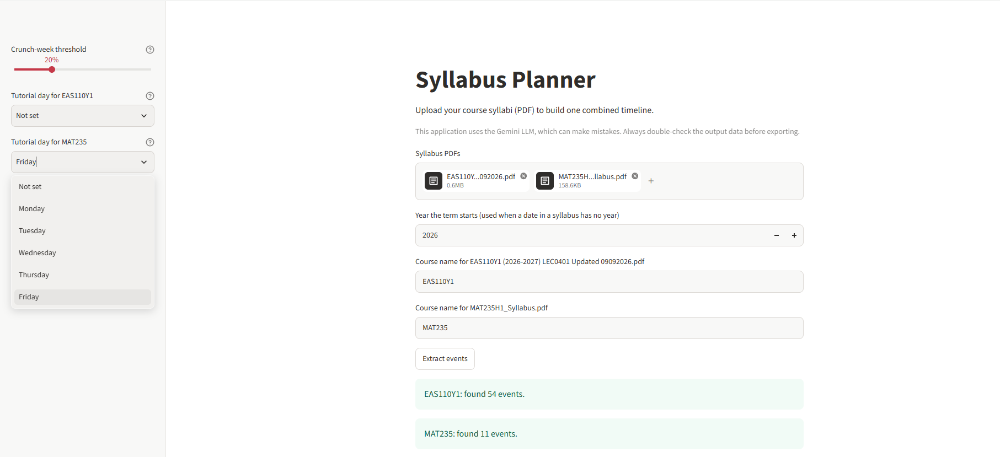
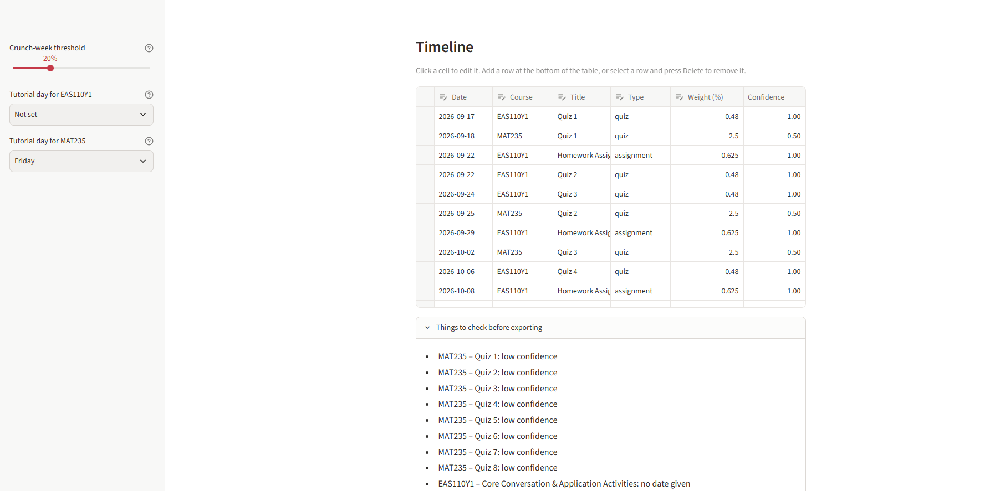
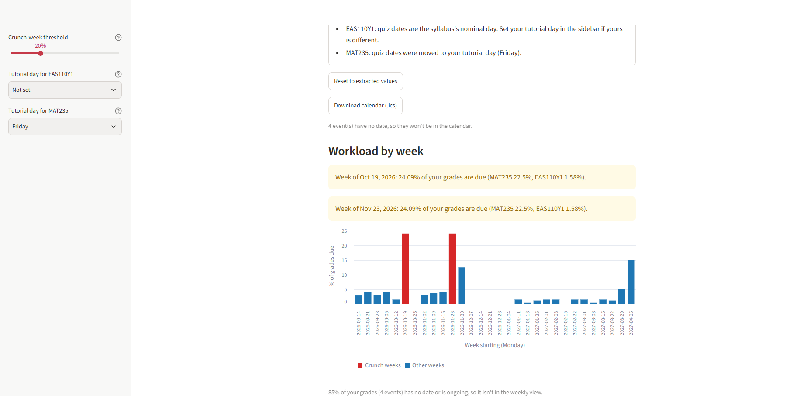

# Syllabus Planner

Upload your course syllabi (PDF) and get one combined timeline of deadlines, exams and grade weights, with crunch-week warnings and a calendar file you can import.





## What it does
1. **Reads** each syllabus PDF and extracts deadlines, exams and weights with an LLM (Gemini, free tier).
2. **Shows** them in an editable table. You fix anything the model got wrong before using it.
3. **Warns** about crunch weeks: weeks where more than a chosen share of your grade is due across all courses.
4. **Exports** the result as an `.ics` file (all-day entries) for Google Calendar, Outlook or Apple Calendar.

## Run it
Requires Python 3.13 and a free [Gemini API key](https://aistudio.google.com/apikey).

```
python -m venv .venv
.venv\Scripts\activate
pip install -r requirements.txt
```
Create a file named `.env` containing `GEMINI_API_KEY=your-key`, then:
```
streamlit run app.py
```
Upload PDFs, set the year the term starts (used for dates that don't state a year), check the course names, and press **Extract events**.

## How it is built
| File | Job |
|---|---|
| `app.py` | Streamlit screen only |
| `planner/pdf_reader.py` | PDF to text (tables kept as rows) |
| `planner/llm.py` | The only file that knows about Gemini: disk cache, retries, model fallback |
| `planner/extractor.py` | Builds the prompt, validates the reply into `Event` objects |
| `planner/models.py` | The `Event` model (pydantic) |
| `planner/workload.py` | Weekly weight totals and crunch-week flags |
| `planner/calendar_export.py` | Events to `.ics` |
| `planner/editing.py`, `adjust.py`, `display.py` | Table editing, tutorial-day shifting, wording for notes and chart |

## Design decisions
- **Model output is never trusted.** Every item is validated; a bad date or weight becomes a blank cell, and a broken item is skipped with a reason shown to the user.
- **Free-tier friendly.** Each reply is cached on disk (`.cache/llm/`), so re-runs cost nothing. Rate limits (HTTP 429) and overload errors are retried with backoff, calls are paced, and after a few failures or a 60-second timeout it moves to the next model (`gemini-3.8-flash`, then `3.6-flash`, then `3.5-flash-lite`).
- **Group weights are split.** "Quizzes 15%" with 31 quizzes becomes about 0.48% each, so totals never exceed what the syllabus says.
- **Unsure dates are marked.** If a syllabus gives only a week, the event is placed on that Monday with low confidence. Quiz days can be moved to your own tutorial day.
- **Repeating items** ("weekly packets 10%") become one undated `ongoing` row rather than invented dates.

## Tests
`pytest` runs about 280 offline tests (no API calls). They include real model replies recorded for four syllabi and checked against hand-labelled answers, plus a check that fails when the prompt changes and a recording is out of date (re-record with `python -m tests.record_reply`). `pytest -m live` runs the same checks against the real model.

## Known limits
- Gemini can make mistakes, so review the table before exporting.
- Items with no single date (finals marked "TBA", ongoing items) are left out of the weekly chart and the calendar; a note shows how much weight that is.
- If a syllabus drops your lowest scores, its weekly totals are a worst case.
- Scanned (image-only) PDFs aren't supported, and only a few University of Toronto syllabi have been tested.
